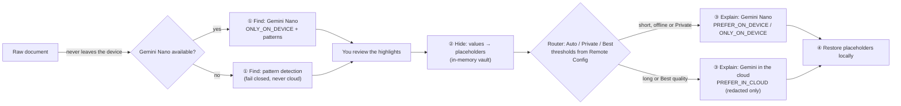

# Kiakia: private AI help with sensitive documents

**Ask AI about your medical, insurance and legal letters without giving away who you are.**

Kiakia finds the names, dates, record numbers and addresses in a document **on your device** with Gemini Nano. It swaps them for placeholders like `[PERSON_1]`, and only then lets an AI read it. Answers come back with your details filled in, locally. A live *privacy receipt* shows every AI call, where it ran and exactly what left the device.

Built for [#BuildHybridAI 2026](https://firebasehybridaihackathon.devpost.com/) with the **Firebase AI Logic hybrid inference SDK** (Web / Chrome).

---

## The problem

People hold their most confusing paperwork in their most private documents: lab results, insurance denials, eviction notices, immigration letters. AI chatbots are very good at explaining these, but using one means uploading your name, date of birth, medical record number and home address to a server.

- Patients paste lab reports into chatbots to find out whether "Ferritin 8 ng/mL LOW" is serious.
- Families facing a claim denial or an eviction notice need to know their deadline and their options *today*.
- Clinics, legal-aid volunteers and caseworkers want AI help but can't send client identifiers to a third-party cloud.

The usual choice is *privacy or capability*. Kiakia uses hybrid inference to give both.

## How Kiakia uses hybrid inference

On-device and cloud models each get the job they're best at. This goes further than "cloud as a fallback":



| Step | Where it runs | Firebase AI Logic mode | Why |
|---|---|---|---|
| **Find** private details in the raw text | Gemini Nano in Chrome | `ONLY_ON_DEVICE` + JSON `responseConstraint` | The raw document must never leave the device. |
| **Explain** a short document | Gemini Nano, cloud fallback | `PREFER_ON_DEVICE` | Instant and free. Input is already redacted, so fallback is safe. |
| **Explain** a long document | Gemini in the cloud, on-device fallback | `PREFER_IN_CLOUD` | Larger context and better reasoning, on redacted text only. |
| **Offline**, or **Private** mode | Gemini Nano only | `ONLY_ON_DEVICE` | Works with no connection; nothing leaves the device. |
| **Follow-up questions** | Routed the same way | per question length | Questions are redacted on-device too (known values + patterns). |

Every answer shows a badge from the SDK's `inferenceSource` (*Answered on this device · Gemini Nano* or *Answered by Gemini in the cloud · saw redacted text only*). If the SDK falls back, Kiakia says so.

### A privacy detail we found in the SDK, and how Kiakia handles it

In the Web SDK, `InferenceMode.ONLY_ON_DEVICE` is enforced by an on-device adapter. That adapter is only created when the browser exposes `window.LanguageModel`. In browsers **without** the Prompt API (Firefox, Safari, older Chrome), no adapter exists and the request goes to the cloud model. You can see this in `getGenerativeModel` → `chromeAdapterFactory` and `callCloudOrDevice` in `@firebase/ai`.

For most apps that's a reasonable default. For a privacy filter it would upload the raw document. So Kiakia **fails closed**: [`assertOnDevice()`](src/ai/onDevice.ts) checks `LanguageModel.availability()` itself before every on-device-only call. It also verifies `inferenceSource === 'on_device'` afterwards. If Gemini Nano isn't available, the Find step falls back to pattern detection, never to the cloud.

## What's in the box

- **Hybrid shield.** Deterministic detectors handle emails, phones, SSNs, Luhn-checked cards, IBANs, labeled record, policy and claim numbers, dates, addresses, PO boxes and labeled names. Gemini Nano adds what patterns miss. Every model detection is checked against the source text to rule out hallucinated entities. The identifier categories are modeled on the HIPAA Safe Harbor list.
- **Human in the loop.** Click any highlight to keep it visible, switch whole categories off, or add a phrase. *Show exactly what the AI will see* displays the redacted text before anything is sent.
- **Consistent placeholders.** The same value always becomes the same token, and a later "Mr. Rivera" shares Jordan A. Rivera's token. The model is told to keep tokens verbatim. Output is restored locally, and dropped brackets or changed case are tolerated.
- **Privacy receipt.** A log of every AI step: device or cloud, characters sent, details withheld, and an *Inspect what was sent* view.
- **Remote Config.** The cloud model name, the Auto-routing threshold and the shield chunk size can change without a redeploy.
- **App Check** with reCAPTCHA Enterprise, plus **limited-use tokens** for replay protection on AI requests.
- **Nothing stored.** No database, no accounts, no analytics. The vault mapping placeholders to real values exists only in the open tab.

## Firebase products used

| Product | Used for | Code |
|---|---|---|
| **Firebase AI Logic** (hybrid inference, Gemini Developer API) | All model calls, on-device and cloud | [`src/ai/engine.ts`](src/ai/engine.ts), [`src/firebase.ts`](src/firebase.ts) |
| **App Check** (reCAPTCHA Enterprise + debug provider for development) | Protects AI Logic; limited-use tokens | [`src/firebase.ts`](src/firebase.ts) |
| **Remote Config** | Cloud model, routing threshold, chunk size | [`src/firebase.ts`](src/firebase.ts), [`remoteconfig.template.json`](remoteconfig.template.json) |
| **Hosting** | Serves the app | [`firebase.json`](firebase.json) |

The core hybrid call ([`src/ai/engine.ts`](src/ai/engine.ts)):

```ts
const model = getGenerativeModel(ai, {
  mode,                                   // chosen per request by src/ai/router.ts
  onDeviceParams: { createOptions, promptOptions: { responseConstraint: SHIELD_SCHEMA } },
  inCloudParams: { model: cloudModel },   // from Remote Config
});
const result = await model.generateContentStream(prompt);
for await (const chunk of result.stream) {
  chunk.inferenceSource;                  // 'on_device' | 'in_cloud' → shown in the UI
}
```

## Setup

You need Node.js 20+, a Firebase project and desktop Chrome.

### 1. Firebase project

1. Create a project at [console.firebase.google.com](https://console.firebase.google.com). The free Spark plan works with the Gemini Developer API.
2. **Add a Web app** (Project settings → Your apps). Copy `.env.example` to `.env.local` and fill in the config values.
3. **Enable Firebase AI Logic** (console → AI Logic → Get started → *Gemini Developer API*), or run:
   ```bash
   npx -y firebase-tools@latest init ailogic
   ```
4. **App Check**: console → App Check → register the web app with **reCAPTCHA Enterprise**. Put the site key in `VITE_RECAPTCHA_ENTERPRISE_SITE_KEY` and allow your domains (`localhost` and `<project>.web.app`). Turn on enforcement for Firebase AI Logic.
5. **Local development**: with `localhost` on the reCAPTCHA key's domain list, `npm run dev` uses reCAPTCHA Enterprise like production does. For environments where reCAPTCHA can't run (CI, a headless browser), create a debug token under App Check → Apps → ⋮ → *Manage debug tokens* and put it in `VITE_APPCHECK_DEBUG_TOKEN` in `.env.local`. **Never commit it.**
6. **Remote Config** (optional; defaults are built in):
   ```bash
   npx -y firebase-tools@latest deploy --only remoteconfig
   ```

### 2. Gemini Nano in Chrome

On-device inference needs desktop Chrome 139+ (Windows, macOS or Linux) with about 22 GB of free disk. Per Chrome's built-in AI docs, it also needs a GPU with more than 4 GB of VRAM, or 16 GB of RAM and 4+ CPU cores.

1. Open `chrome://flags/#prompt-api-for-gemini-nano` and set it to **Enabled**. If `#prompt-api-for-gemini-nano-multimodal-input` exists, enable it too. Relaunch Chrome.
2. In Kiakia, click **Download** in the status bar. Chrome only allows the download after a click. Progress shows in the chip, and `chrome://on-device-internals` shows the model state.

Without Gemini Nano, Kiakia still works: detection uses patterns, answers come from the cloud on redacted text, and the UI explains why.

### 3. Run

```bash
npm install
npm run dev      # http://localhost:5173
npm test         # privacy + routing unit tests
```

### 4. Deploy

```bash
npm run build
npx -y firebase-tools@latest deploy --only hosting
```

## Project layout

```
src/
  ai/
    engine.ts       hybrid models, on-device shield, streaming answers
    onDevice.ts     Gemini Nano availability + fail-closed privacy guard
    router.ts       Auto / Private / Best routing decisions
    prompts.ts      shield prompt + JSON schema, per-document-type prompts
  privacy/
    detectors.ts    deterministic identifier patterns
    spans.ts        occurrence expansion, overlap merging
    vault.ts        placeholders ⇄ real values (in memory only)
  components/       UI: status bar, compose, review, conversation, receipt
  firebase.ts       Firebase init, App Check, AI Logic, Remote Config
```

## Limitations

- Detection can miss things, so Kiakia asks you to review the highlights before anything is sent. Context can still identify someone ("the only cardiologist in a small town"), and no automatic redaction is perfect.
- Gemini Nano has a small context window. Long documents are scanned in slices, and Auto routing sends long *redacted* documents to the cloud.
- On-device inference needs desktop Chrome with Gemini Nano. Other browsers get the pattern shield and cloud answers.
- Kiakia gives general information, not medical, legal or financial advice.

## License

[Apache-2.0](LICENSE). All sample documents are fictional.
